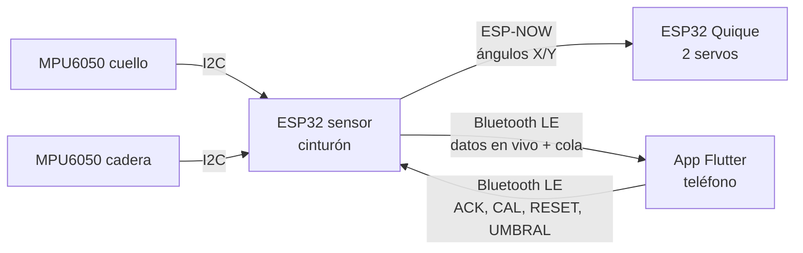

# proyecto-Quique — "La espalda no espera"

Sistema *phygital* de salud postural para niños, desarrollado como **memoria de título de Diseño** en la Universidad Diego Portales (Escuela de Diseño, FaAAD).

El sistema se compone de tres partes principales:

1. **Cinturón (wearable):** dos sensores en la espalda (cuello y cadera) que detectan cuándo el niño se encorva o se inclina hacia un lado, y registran esos episodios aunque no haya un teléfono cerca.
2. **App (Flutter):** dos "mundos". El del **apoderado** muestra la postura del día y su historial. El del **niño** tiene juegos guiados por Quique para aprender a reconocer y controlar su postura.
3. **Quique (juguete):** personaje-juguete físico (un *quique*, mustélido chileno) que imita la postura del niño con dos servomotores.

> **Estado:** prototipo de investigación, preparado para un testeo con usuarios (etapa F, octubre de 2026). **No es un dispositivo médico** y no está validado clínicamente.

---

## Contenido del repositorio

```
proyecto-Quique/
├── lib/                      App Flutter (código Dart)
├── android/, ios/, …         Plataformas de Flutter
├── pubspec.yaml              Dependencias de la app
├── firmware/
│   ├── emisor_sensor/        ESP32 del cinturón (sensores + Bluetooth + ESP-NOW)
│   │   └── emisor_sensor.ino
│   └── receptor_quique/      ESP32 de Quique (ESP-NOW + servos)
│       └── receptor_quique.ino
├── README.md
└── CHANGELOG.md              Cambios por etapa
```

---

## Hardware

| Componente | Modelo | Cantidad | Uso |
|---|---|---|---|
| Microcontrolador del cinturón | ESP32 DevKit V1 (ESP-WROOM-32) | 1 | Lee los sensores, guarda episodios y se comunica con la app por Bluetooth |
| Acelerómetro/giroscopio | MPU6050 (módulo GY-521) | 2 | Uno en el cuello (dirección I2C `0x68`) y otro en la cadera (`0x69`) |
| Microcontrolador de Quique | ESP32 DevKit V1 | 1 | Recibe la postura por ESP-NOW y mueve los servos |
| Servomotores | SG90 | 2 | Pan-tilt de Quique (adelante/atrás y lateral) |
| Alimentación de los servos | 4 pilas AA (6 V) | 1 portapilas | Fuente **separada** del ESP32 |
| Alimentación del cinturón | [batería / power bank / USB] | 1 | |

### Conexiones del cinturón (ESP32 sensor)

Los dos MPU6050 comparten el mismo bus I2C. Se distinguen por su dirección: el de la cadera tiene el pin **AD0 conectado a 3.3 V**, lo que cambia su dirección a `0x69`.

| MPU6050 | Cuello (`0x68`) | Cadera (`0x69`) |
|---|---|---|
| VCC | 3.3 V | 3.3 V |
| GND | GND | GND |
| SDA | GPIO 21 | GPIO 21 |
| SCL | GPIO 22 | GPIO 22 |
| AD0 | sin conectar (o GND) | **3.3 V** |

> **Importante:** ambos sensores deben ir montados **con la misma orientación**. El sistema compara los sensores del cuello contra cadera eje por eje: si un sensor está girado respecto del otro, la diferencia sale grande aunque la persona esté derecha. Con el montaje actual, X = adelante/atrás e Y = lateral. Encorvarse hacia adelante da `difXs` negativo, e inclinarse a la izquierda da `difYs` negativo.

### Conexiones de Quique (ESP32 receptor)

| Elemento | Conexión |
|---|---|
| Servo 1 (señal) | GPIO [nº] |
| Servo 2 (señal) | GPIO [nº] |
| Servos (+) | + del portapilas (6 V) |
| Servos (−) | − del portapilas **y** GND del ESP32 (tierra común) |

> Los servos **nunca** se alimentan desde el pin 3.3 V o 5 V de la placa: las caídas de voltaje reinician el ESP32 o dañan su regulador.

---

## Cómo se comunica el sistema



- **Cinturón → Quique (ESP-NOW):** cada ~330 ms el cinturón envía los ángulos del cuello directamente al ESP32 de Quique, sin router ni teléfono. Quique imita al niño en todo momento.
- **Cinturón ↔ App (Bluetooth LE):** solo el ESP32 del cinturón usa Bluetooth. Quique no se conecta con la app.
  - **Datos en vivo** (notify, ~3 por segundo), en JSON: diferencias cuello − cadera con signo (`difXs`, `difYs`), si hay mala postura y qué calibración está cargada. La app los usa en los juegos.
  - **Cola de episodios:** el cinturón guarda en su memoria flash cada episodio de mala postura de más de 3 s (hasta 100 episodios), con el tiempo que pasó encorvado, inclinado o ambos. La app los lee por tandas, los guarda y recién entonces confirma con `ACK:<id>` para que el cinturón los borre. Nada se pierde si se corta la conexión.
  - **Comandos de la app:** `CAL:<x>,<y>,<id>` carga la postura neutral calibrada de cada niño, `RESET` vuelve al cero predeterminado, `UMBRAL:<adelante>,<lateral>` fija los umbrales y `BORRAR_TODO` vacía la cola.
- **La hora la pone el teléfono:** el ESP32 no sabe qué hora es. Guarda `millis()` y un contador de encendidos, y la app calcula la fecha y hora real de cada episodio.
- **Sin servidor:** todos los datos quedan en el teléfono (`shared_preferences`). No hay cuentas ni internet.

| Bluetooth LE | UUID |
|---|---|
| Servicio | `4fafc201-1fb5-459e-8fcc-c5c9c331914b` |
| Datos en vivo (READ, NOTIFY) | `beb5483e-36e1-4688-b7f5-ea07361b26a8` |
| Registro y comandos (READ, WRITE) | `a1b2c3d4-0002-4e5f-8a9b-1234567890ab` |

Nombre del dispositivo: `ESP32_Sensor_Postura`.

---

## Entorno de desarrollo y versiones

### App

| Herramienta | Versión |
|---|---|
| Flutter | 3.47.2 (stable) |
| Dart | 3.13.2 |
| Gradle | 9.3.1 |
| Android Gradle Plugin | 9.1 |
| Kotlin | 2.4 |
| Editor | Visual Studio Code (extensiones Flutter y Dart) |
| Android SDK | vía Android Studio (solo SDK y emuladores) |
| Teléfono de prueba | Samsung S20 FE, Android 13 |

| Paquete (pubspec) | Versión | Para qué |
|---|---|---|
| `flutter_blue_plus` | 1.36.8 | Bluetooth LE |
| `permission_handler` | [ver `pubspec.lock`] | Permisos de Bluetooth y ubicación |
| `shared_preferences` | [ver `pubspec.lock`] | Guardar datos en el teléfono |

La app **no usa más dependencias**: la figura animada, los íconos de los animales, el confeti y los gráficos se dibujan con código. // (Esto cambiará en las siguientes versiones con ilustraciones propias)

### Firmware

| Herramienta / biblioteca | Versión |
|---|---|
| Arduino IDE | 2.3.10 |
| Núcleo ESP32 (*esp32 by Espressif Systems*) | [versión] |
| Adafruit MPU6050 | 2.2.9 |
| Adafruit Unified Sensor | [versión] |
| Adafruit BusIO | [versión] (se instala con la anterior) |
| BLE (`BLEDevice`), `Preferences`, `esp_now`, `WiFi`, `Wire` | incluidas en el núcleo ESP32 |

---

## Autor

**Sebastián Sáez** — Diseño, Universidad Diego Portales, 2026.  
Profesor guía: Sergio Majluf.  
Profesor adjunto: Simón Gallardo.  

Proyecto académico. [Licencia: por definir, p. ej. «Todos los derechos reservados» o MIT].